<!-- ====================================================================
     Vũ Đình Đạt · GitHub profile README
     Banner: assets/banner.svg (animated, self-hosted)
     Snake:  .github/workflows/snake.yml → branch "output"
     ==================================================================== -->

  

  &nbsp;&nbsp;
  &nbsp;&nbsp;
  &nbsp;&nbsp;
  &nbsp;&nbsp;
  

---

## 👨‍💻 About me

I'm a **Software & IoT engineer** who likes building the *whole* system — from **firmware on ESP32 / STM32**, through **Android apps** with on-device computer vision, to **backend APIs** and the **web UI** on top.

- 📱 Shipping **Android** apps in Kotlin & Java — driver drowsiness detection, home-screen system widgets
- 🌐 Writing **ASP.NET Core** backends and **React** web apps
- 🎓 Software Engineering @ **ICTU – Thai Nguyen University** · GPA **3.78/ 4.0**
- 🤖 Using AI agents as a daily part of my engineering workflow
- 🎯 Next goal: **IELTS 6.5** (2027)

## 🧰 Tech stack

<b>Languages</b>

  

<b>Frameworks · Platforms</b>

  

<b>Embedded · Tools</b>

  

## 🚀 Featured projects

<table>
<tr>
<td width="50%" valign="top">

### 🚗 [DMS — Driver Monitoring System](https://github.com/Vudinhdat02/dmsApplication)
Android app that detects **drowsiness & distraction on-device** (eye closure, yawning, head turning, face absence) and warns with sound and vibration. Personal calibration, crash detection with motion sensors + GPS, cloud backup and AI safety insights via an ASP.NET Core backend.

<b>Tech:</b> Kotlin · MediaPipe · CameraX · ASP.NET Core · Firebase

</td>
<td width="50%" valign="top">

### 🛸 [TC-UAV-ICTU — Flight controller](https://github.com/Vudinhdat02/TC-UAV-ICTU)
STM32 **flight-controller firmware** for a custom quadcopter: nested attitude/rate PID with self-levelling, GPS position hold & return-to-home, IMU + barometer + magnetometer fusion, arming checks and failsafe landing.

<b>Tech:</b> C · STM32F103 · PID · PlatformIO

</td>
</tr>
<tr>
<td width="50%" valign="top">

### 🎮 [RC-UAV-ICTU — Radio link](https://github.com/Vudinhdat02/RC-UAV-ICTU)
Custom **UAV remote-control system on ESP32-S3**: handheld transmitter + on-board bridge over ESP-NOW with CRC-16 protected packets, OLED telemetry, flight modes (Stabilize · Alt Hold · Pos Hold), RTH and auto take-off/landing.

<b>Tech:</b> C++ · ESP32-S3 · ESP-NOW · GPS

</td>
<td width="50%" valign="top">

### 📊 [MemoryWidget](https://github.com/Vudinhdat02/MemoryWidget)
Lightweight Android app with **8 home-screen widgets** showing live RAM, storage, battery and device info. Liquid-glass styles, adjustable transparency, Material You colours, one-tap RAM cleanup — pure Java, no internet permission.

<b>Tech:</b> Java · Android · Material You

</td>
</tr>
<tr>
<td width="50%" valign="top">

### 📚 [Auto Vocab Saver](https://github.com/Vudinhdat02/vocabulary-saver-extension)
Chrome extension for English learners: highlight a word, press <kbd>Ctrl</kbd>+<kbd>C</kbd> and it is looked up and saved with its word type and Vietnamese meanings. Draggable vocabulary popup and CSV export.

<b>Tech:</b> JavaScript · Chrome MV3

</td>
<td width="50%" valign="top">

### 🖍️ [Highlighted Vocabulary Extractor](https://github.com/Vudinhdat02/Tool-for-extracting-highlighted-vocabulary-from-text)
Web tool that scans an uploaded image and **extracts the words highlighted in blue**; double-click to add words manually and copy the list in one click.

<b>Tech:</b> JavaScript · HTML5 · Image processing

</td>
</tr>
</table>

  <a href="https://vudinhdat02.github.io"><b>🌐 See everything on my portfolio →</b></a>

## 🏆 Highlights

| | |
|:--|:--|
| 🥈 | **2nd prize** — Open-Source Software Development Contest (ICTU, 2026) |
| 📄 | Research paper in **TNU Journal of Science and Technology** ([link](https://jst.tnu.edu.vn/jst/article/view/15917)) · 2 papers at the **ICTA** international conference |
| 🎓 | Bachelor thesis scored **highest of the committee** (2026) |
| 💎 | **Excellent-student scholarship** every year · GPA **3.78 / 4.0** |
| 🌟 | **"5-Good Student"** & **Outstanding Student** of Thai Nguyen University (2024 – 2025) |

## 📈 GitHub stats

  

  <picture>
    <source media="(prefers-color-scheme: dark)" srcset="https://raw.githubusercontent.com/Vudinhdat02/Vudinhdat02/output/github-snake-dark.svg"/>
    <source media="(prefers-color-scheme: light)" srcset="https://raw.githubusercontent.com/Vudinhdat02/Vudinhdat02/output/github-snake.svg"/>
    
  </picture>

---

  

